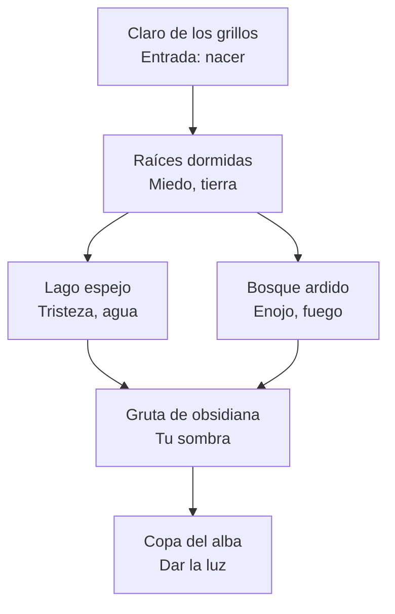

# Onward — la luz que se pasa de mano en mano

Documento de diseño (1 nov 2026). Reemplaza la versión anterior ("el bosque que se dibuja"); lo que se reutiliza de ella está al final.

## 1. Idea

| | |
|---|---|
| **Género** | Aventura contemplativa en 3D, sin combate |
| **Para quién** | Cualquier edad; jugadoras de Sky, Journey o Gris |
| **Emoción** | Esperanza: lo que se apagó todavía guarda la luz que fue |
| **Tema de la jam** | *You Hear* ("Oyes"): la canción da esperanza, brillos, luz, naturaleza, grillos |
| **Referencias** | Sky y Journey (sentir algo juntos sin palabras), Gris (el mundo cambia con la emoción), *Las crónicas de Spiderwick* (ver lo invisible, seres que cambian según cómo los tratas), *Hierophants* (dar lo tuyo a otra persona) |
| **Lo nuevo** | La luz pasa de un jugador real al siguiente; escuchar es la forma de orientarse |

**Historia en una frase:** una elfa recién nacida cruza un bosque nocturno sin nada; por el camino encuentra una brasa frágil y un espejo de obsidiana, se encuentra con sus emociones convertidas en seres, aprende a cuidarlas y al final da su luz a la próxima persona que juegue.

**El sentido:** la obsidiana es fuego que se volvió oscuro (lava enfriada). Alguien te dio luz sin conocerte; tú la das sin saber a quién. Es el viaje del **Mago** (va reuniendo sus herramientas y todavía no sabe quién es) a la **Emperatriz** (da vida y cuida a otra).

**Las herramientas se encuentran, no se tienen:** nace con las manos vacías. Primero encuentra la brasa (la esperanza) y después, gracias al miedo que calmó, el espejo (poder mirarse). Cada objeto es un paso de su historia.

## El mundo: un bosque sobre un volcán dormido

Hace mucho, una erupción quemó el bosque. Por eso está apagado y por eso hay obsidiana en la tierra. Todo lo que aparece en el juego sale de esa historia: **un lugar que se quemó y vuelve a vivir**, igual que la elfa.

- **La obsidiana:** fuego que se volvió oscuro. El espejo es un resto de aquella erupción, guardado entre las raíces.
- **Los hongos:** cuando la lava se enfría, la primera vida que aparece sobre la roca son los líquenes (en parte hongos); empiezan a convertir la piedra en suelo y el bosque vuelve a crecer. Por eso son **los refugios de la brasa**: la prueba de que después del fuego la vida regresa.
- **El ser del enojo:** el espíritu del volcán, el fuego que una vez lo destruyó todo. Calmado, enciende las hogueras para dar calor.
- **Se cuenta sin texto, con el paisaje:** rocas negras de lava vieja, grietas con brillo tenue, hongos y líquenes creciendo sobre la piedra, y el volcán dormido a lo lejos, siempre visible.

## Orientación: quién es, qué tiene que hacer, cuánta luz le queda

- **La misión, siempre visible:** a lo lejos, la Copa del alba con la luz de quien espera. Destella al tomar la brasa y el espejo.
- **La escena del principio (~19 s):** la cámara muestra esa luz; una elfa dorada (el jugador anterior) camina hasta la hoguera, deja la brasa, mira la luz y se desvanece; donde estuvo, nace la elfa. Dos frases: *"Someone left a light for you."* · *"Carry it to the one who waits."*
- **Cuánta luz le queda, sin números:** una brasa abajo a la izquierda que se achica, se enfría y tiembla; los bordes de la pantalla se oscurecen; un sonido grave de aviso; el refugio encendido más cercano late.
- **Pistas de luz:** lo que espera algo late (las luces del camino del miedo después de que se esconde; el refugio donde esperar a que salga); los grillos cantan donde hay algo dormido.

## 2. Controles

- **Moverse** (W A S D / palanca en el móvil) y **correr** (Tab).
- **Mantener el espejo** (Espacio / clic derecho; botón *Mirror* en el móvil): ver el mundo a través de la obsidiana.
- **Dar luz** (E; en el móvil, el botón de abajo): pasar parte de la brasa a algo.

## 3. Los sistemas

### La brasa — la tensión
- Es tu luz y tu "tiempo": lejos del fuego se apaga en unos 25 s.
- Al debilitarse: luz más chica, parpadeo, el sonido se apaga, bordes de pantalla oscuros. Sin números en pantalla.
- **Correr** gasta más brasa pero llegas antes: riesgo que eliges tú.
- Se recarga en **hogueras** y **círculos de hongos** (refugios: la primera vida que volvió después del fuego).
- **Si se apaga no se muere:** queda una chispa que vuela al último refugio y la sigues (≈5 s perdidos, nada más).

### Dar luz — la decisión
- Cuesta brasa. Encender un círculo de hongos crea un **refugio nuevo** donde quieras.
- Cada tramo oscuro es un pequeño plan: ¿enciendo este círculo o guardo la brasa para llegar más lejos?

### El espejo — el descubrimiento
- Muestra lo invisible: caminos, puentes, recuerdos, lo que siente cada ser.
- **Con la brasa:** lo que solo se ve en el espejo, si lo iluminas, **se vuelve real** (p. ej. un puente).
- Mientras lo usas caminas más lento: no se puede usar siempre.

### Dar a la naturaleza — la regla del juego
**Cuando das luz, la naturaleza te devuelve un pedacito de ti misma.** Dar no te deja con menos: te ayuda a encontrarte.
- **Dar cuesta:** encender una flor dormida, un árbol o un círculo de hongos gasta brasa; en el momento te quedas con menos luz.
- **La naturaleza responde:** lo que despiertas florece y suelta un **recuerdo**, un brillo pequeño que vuela hacia ti. Al tocarlo se ve un instante de su propio viaje: su nacimiento, la elfa dorada, el miedo que calmó.
- **El reflejo se completa:** cada recuerdo agrega un detalle a su rostro en el espejo (los ojos, la sonrisa, el pelo con flores). El rostro final no aparece de golpe: se arma con lo que dio.
- **La brasa crece:** cada regalo hace que la brasa dure un poco más. Quien da más, llega más lejos.
- **No es obligatorio:** quien solo avanza termina con un reflejo sencillo; quien se detiene a dar ve un rostro más completo y más recuerdos. Sin puntos ni números en pantalla.
- La versión grande de esta regla son los seres: el miedo, al calmarse, le da el espejo.

### Escuchar — la orientación (tema *You Hear*)
- Sin mapa ni flechas. Grillos, brillos y sonidos de la canción salen de donde hay algo dormido (sonido posicional).
- El oído encuentra, el espejo muestra, la brasa despierta.

### Los seres dan poderes
Cada ser calmado te acompaña y da una habilidad que hace falta en la zona siguiente.

### Cómo ayudar a un ser (regla de diseño)
1. No dice qué le pasa: se deduce mirando cómo se mueve y qué hay alrededor.
2. El primer impulso no funciona (acercarse directo lo empeora).
3. La mejora se ve de a poco (color, postura, sonido).
4. Cada uno necesita una ayuda distinta.

### La música crece
Cada ser calmado suma un instrumento; al amanecer la canción suena completa.

## 4. El recorrido (15–20 min)

Sigue el mapa del reino (sección 7) en su versión corta: **Claro de los grillos → Raíces dormidas → (Bosque ardido) → Gruta de obsidiana → Copa del alba**. Se va de abajo hacia arriba: de la lava vieja y las raíces a la copa del árbol donde amanece. El volcán dormido se ve siempre a lo lejos.

| # | Lugar | Qué pasa | Desafío | Recompensa |
|---|---|---|---|---|
| 0 | **Claro de los grillos** (2 min) | Nace de noche, sin nada, sobre roca negra de lava vieja cubierta de líquenes. Un rastro dorado tenue (el camino del jugador anterior) y el canto de los grillos la llevan a una hoguera casi apagada: ahí la espera **la brasa** que dejó otra elfa, que aparece dorada un instante y se desvanece | Aprender sin texto: escuchar para orientarse, seguir el rastro; la brasa baja lejos del fuego y se recarga en los círculos de hongos | **La brasa**. Primer regalo de la naturaleza: una flor dormida junto a la hoguera devuelve el recuerdo de su nacimiento |
| 1 | **Raíces dormidas** — el miedo, ser de tierra (5 min) | Un bosque bajo raíces enormes que crecieron sobre la lava. El ser se esconde; si te acercas, las raíces se cierran más. Todavía no hay espejo: solo se le puede leer por cómo se mueve | Encender 3 círculos de hongos que formen un camino desde su escondite, con la brasa justa; alejarse para que salga solo | Abre las raíces y saca de la tierra **el espejo de obsidiana**, un resto de la erupción. Al mirarse por primera vez, su reflejo no tiene rostro. Con el ser al lado, la brasa dura más |
| 2 | **Bosque ardido** — el enojo, espíritu del volcán (5 min, *extra*) | Árboles quemados al pie del volcán. El espíritu lanza chispas. El espejo muestra que su hogar (un círculo de piedras) está roto | Encontrar las piedras siguiendo grillos y brillos, esquivar chispas, rearmar su hogar y darle luz | Se encienden todas las hogueras; la brasa se vuelve llama y se puede reflejar con el espejo |
| 3 | **Gruta de obsidiana** — la sombra (3 min) | Una cueva de vidrio volcánico: las paredes son espejos. Su sombra solo aparece en el reflejo y **copia sus movimientos al revés** | Mirarla en el espejo y caminar hacia atrás guiándose por el reflejo; al alcanzarla, darle luz | La sombra se vuelve luz |
| 4 | **Copa del alba** — el final (2 min) | Sube por el árbol gigante hasta la copa. Amanece y suena la canción completa. Llega a la recién nacida (el próximo jugador) y mantiene "dar luz" para entregarle la llama | — | Se mira por última vez: su reflejo tiene rostro, encendido, con los detalles que le devolvió la naturaleza. La cámara sube y se ve todo su camino florecido sobre el volcán dormido |

**Regalos de la naturaleza por el camino:** en cada lugar hay flores, árboles y hongos dormidos (algunos fuera del camino o visibles solo en el espejo). Darles luz cuesta brasa y devuelve recuerdos que completan el rostro del reflejo final y hacen que la brasa dure más.
**Ritmo:** se alterna tensión (cruzar la oscuridad) y calma (refugios, seres calmados). Algo nuevo cada 1–2 min. Cada acción responde con sonido y brillos.
**Para todas las edades:** no se muere, sin textos, nunca atascada mucho tiempo.

## 5. La luz entre jugadores

- Al terminar, se guarda el camino de la jugadora (lista de puntos, sin datos personales).
- Al empezar, se lee el camino de un jugador anterior al azar: es el rastro dorado tenue que la lleva hasta la brasa, y la elfa dorada que aparece un instante junto a ella.
- Servicio pequeño en Cloudflare (Pages Functions + KV, gratis), el mismo sitio donde ya se publica el juego.
- Sin internet (o en la versión de escritorio sin conexión): se usa un camino de ejemplo.

## 6. Para la jam (cierre: 8 nov, 8:59 hora de España)

| Día | Qué se hace |
|---|---|
| Lun 2 | La brasa: encontrarla en la hoguera, se apaga lejos del fuego, refugios de hongos, la chispa que vuelve |
| Mar 3 | El ser del miedo y los sonidos que guían |
| Mié 4 | El espejo: sale de la tierra al calmar el miedo; ver lo oculto y darle luz para que se vuelva real |
| Jue 5 | La sombra que se mueve al revés |
| Vie 6 | El final y el traspaso entre jugadores |
| Sáb 7 | Pulir, música por capas, que alguien lo pruebe, subir a itch.io |

Lo esencial: despertar, miedo, sombra, final. El enojo, si sobra tiempo (las hogueras y el bosque oscuro ya existen).

## 7. Propuesta de reino para Sky: el Bosque de Obsidiana

El juego es todo original (elfa, bosque, seres propios). Esta propuesta va solo como texto en la página de itch.io. **Antes de entregar: preguntar en el Discord de la jam si les parece bien mencionar Sky.**

| Área | Lo que la distingue |
|---|---|
| **Claro de los grillos** | Círculo de hongos encendidos bajo un cielo nocturno; aquí nacen los recién llegados y se oye la canción por primera vez |
| **Raíces dormidas** | Bosque bajo tierra entre raíces enormes que se abren cuando el miedo se calma |
| **Lago espejo** | La superficie muestra un bosque reflejado que no existe arriba |
| **Bosque ardido** | El bosque de las hogueras; el enojo que se calma y enciende todo |
| **Gruta de obsidiana** | Paredes que son espejos; aparece tu sombra |
| **Copa del alba** | La copa de un árbol gigante donde amanece; los veteranos dan su luz a los recién llegados |

- **Lo nuevo para Sky:** un reino nocturno que se ilumina con lo que hacen los jugadores; se recorre de las raíces a la copa y termina volando hacia el amanecer.
- **Tu luz se apaga en la oscuridad**, salvo de refugio en refugio o **con otros jugadores**: juntos dura más (motivo para ir de la mano).
- **Espejos de obsidiana:** muestran recuerdos ocultos de los ancestros.
- **Seres-emoción:** no se recolectan; se acompañan y se calman.
- **Escuchar guía:** los sonidos llevan a lo dormido.
- **Lo social:** al final, los veteranos pasan su luz a los recién llegados; acompañar a otros es el centro del reino.

**El juego de la jam recorre una versión corta del mapa:** Claro → Raíces → Gruta → Copa. El lago y el bosque ardido quedan como parte de la propuesta (o extras).

## 8. Arquitectura

- **3D con React Three Fiber**: canvas 3D + una capa HTML encima para los textos.
- **Estado:** objetos que cambian en cada frame (sin estado de React), como en el resto del juego.
- **Se reutiliza del prototipo anterior** (`src/simbolos/`): la elfa, la cámara y los controles; el rastro que florece y el "mapa de vida" (`blooms.ts`); el bosque oscuro, las hogueras y el muro de sombra; la cámara final desde arriba (`Scene.tsx`); los seres de tierra y fuego como base visual.
- **Se deja de usar:** el reconocedor de símbolos (`recognizer.ts`) y dibujar figuras con los pasos.
